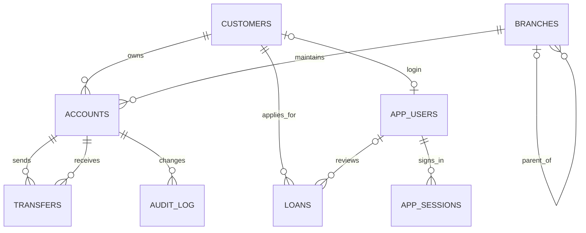

# Vault DBMS project — from the beginning

This guide starts with the problem the database solves, then explains the tables and their links. The final sections give you commands to execute and describe for the evaluator.

## 1. What does the application do?

Vault is a small bank application. A customer can view their accounts, send money to another Vault account and apply for a loan. Bank staff can register customers, verify KYC, open or freeze accounts, and review loans. MySQL stores the data and protects it with keys, constraints and transactions.

The app has two layers:

```text
Next.js screens → Next.js API → SQL → MySQL
```

The screen sends a request to the API. The API checks the signed-in user's role and account ownership, then runs SQL. MySQL sends rows back to the API, and the API returns them to the screen.

## 2. What is a table?

A table stores one kind of thing. A row is one instance of it; a column stores one fact about that instance.

For example, one row in `customers` stores one bank customer. `customers.id` identifies that row. An account stores the customer's `id` in `accounts.customer_id` to say who owns it.

## 3. Tables in this project

There are eight application tables.

| Table | One row represents | Important data |
|---|---|---|
| `customers` | A bank customer | Name, email, phone and KYC JSON document |
| `branches` | A bank branch | Name, city and optional parent branch |
| `accounts` | One customer's bank account | Unique number, owner, branch, account type, balance, status |
| `transfers` | One movement between two accounts | Sender account, receiver account, amount and description |
| `loans` | One loan or loan application | Borrower, product, principal, rate, term and status |
| `audit_log` | One account balance change | Account, old balance, new balance and time |
| `app_users` | One login identity | Name, email, password hash, role and optional customer link |
| `app_sessions` | One signed-in browser session | Hashed session token, user and expiry time |

The SQL definitions live in [01-schema.sql](../sql/01-schema.sql). Sample rows are inserted by [02-seed.sql](../sql/02-seed.sql).

## 4. Keys and constraints

- A **primary key (PK)** uniquely identifies each row. Example: `customers.id`.
- A **foreign key (FK)** points to a row in another table. Example: `accounts.customer_id` points to `customers.id`.
- **UNIQUE** prevents duplicate values, such as two customers using the same email.
- **NOT NULL** requires a value.
- **CHECK** limits acceptable values, such as a balance being zero or greater.

These rules let MySQL reject invalid data even when a user or API makes a mistake.

Money uses `NUMERIC(16,2)` so it can store exact decimal amounts, for example `1250.75`.

## 5. How the tables connect

Open the [Chen ER diagram](../diagrams/01-er-diagram.svg) or [diagram gallery](../diagrams/index.html). A rectangle is an entity/table, a diamond is a relationship, and an oval is an attribute/column. Underlined ovals are primary keys. Relationship labels show minimum and maximum participation: `(0,N)` means zero or many, `(1,1)` exactly one, and `(0,1)` optional one.



### The relationships, one by one

**Customer to accounts — one-to-many.** One customer may have no accounts or several. Every account belongs to exactly one customer. The database implements this with `accounts.customer_id` referencing `customers.id`.

**Branch to accounts — one-to-many.** One branch maintains many accounts; each account belongs to one branch. `accounts.branch_id` references `branches.id`.

**Branch to branch — recursive one-to-many.** A branch can have child branches. One branch can have zero or one parent. `branches.parent_id` references another row in `branches`. Head Office is the root in the sample data.

**Customer to loans — one-to-many.** A customer can apply for several loans; a loan belongs to one customer. `loans.customer_id` references `customers.id`.

**Account to transfer — two relationships.** Every transfer has exactly one sending account (`from_account`) and one receiving account (`to_account`). An account can appear in many transfers in either role. Both columns reference `accounts.id`. A transfer must not send money to itself.

**Account to audit log — one-to-many.** One account may have many balance change records. Each audit row refers to one account through `audit_log.account_id`.

**Customer to login — optional one-to-one.** A customer can have at most one login; a customer login must point to one customer. Employee and admin logins have no customer profile. `app_users.customer_id` is a unique foreign key and a CHECK constraint enforces the role rule.

**User to sessions — one-to-many.** A user may have multiple browser sessions. Each session has one owner through `app_sessions.user_id`.

**User to reviewed loan — optional one-to-many.** One staff user may review many loans; a loan has no reviewer while pending and at most one reviewer after decision. `loans.reviewed_by` references `app_users.id`. The API restricts this action to admins.

### Chen attributes that matter

KYC is a **composite conceptual attribute**: the JSON object has `verified`, `occupation`, and `risk` components. The application stores this object in one MySQL JSON column, `customers.kyc`.

EMI is a **derived attribute**. It is calculated from loan principal, rate, and term by `monthly_emi()`; the app does not store it as a loan column.

The supplied reference image shows a **multivalued attribute** with a double oval. Chen notation also represents a **weak entity** with a double rectangle. This database has neither. A customer phone is one text value. All eight tables have their own primary key, so none is weak. The notation key shows the symbols, but the bank ER diagram does not pretend they are part of the schema. A weak entity would need an owner's key plus its own partial key for identification.

## 6. What happens during a transfer?

Suppose Aarav sends ₹100 to Diya:

1. The customer enters their source account, Diya's account number, and the amount.
2. The API checks that the customer owns the source account.
3. The API looks up the receiving account and starts a database transaction.
4. It calls `transfer_funds(source, destination, amount, note)`.
5. The function checks that the accounts are active, the amount is valid, and the sender has enough money.
6. The function locks both account rows, subtracts ₹100 from the sender, adds ₹100 to the receiver, and inserts a transfer record.
7. Each balance update activates the `balance_audit` trigger. It writes the old and new balance to `audit_log`.
8. MySQL commits the transaction. If a check fails, the changes roll back.

If the sender had ₹500 and the receiver had ₹300, after the transfer they have ₹400 and ₹400. Together they still have ₹800. An internal transfer moves money; it does not create money.

A successful transfer creates one `transfers` row and normally two `audit_log` rows. The function and trigger definitions are in [01-schema.sql](../sql/01-schema.sql). The API calls them from [the bank route](../app/api/bank/route.js).

## Evaluator commands

Run the [five MySQL and MongoDB demos](../demo/README.md) for DDL/DML, reports, trigger, function, privileges and document queries.

## 8. The application itself

Start the application from the project folder:

```sh
npm run dev
```

Open http://localhost:3000. Sign in with one of the demo users below. The sign-in page also has buttons to fill in a demo login.

| User | Email | Password | What to show |
|---|---|---|---|
| Aarav Sharma | `aarav@example.com` | `VaultDemo123!` | Customer home, balances, transfers and own loans |
| Diya Patel | `diya@example.com` | `VaultDemo123!` | Second customer's separate accounts and received transfers |
| Bank employee | `employee@vault.bank` | `VaultDemo123!` | Customer list, KYC checks, account servicing and bank reports |
| Bank admin | `admin@vault.bank` | `VaultDemo123!` | Employee tools, loan decisions, audit history and reports |

### Customer screens

After Aarav signs in, the customer home screen shows his combined account balance, account cards, and recent transfers. **My accounts** lists his accounts. **Payments** lists his incoming and outgoing transfers. **My loans** shows his loan records and an application form. **My profile** shows contact information and KYC status.

To demonstrate a transfer, click **Send money**. Choose Aarav's Savings account, enter `VB10002` as the recipient account, and enter `100`. Confirm the transfer. The account balances and transfer history refresh. Sign out and sign in as Diya to show the incoming transfer from her view.

The transfer updates two accounts; total bank balances stay the same. The API checks that a customer owns the source account. Try choosing another customer's source account through a direct request and the API rejects it.

### Employee screens

The employee workspace shows bank records for servicing. In **Customers**, review customer details and verify a pending KYC status. In **Accounts**, open a Savings or Current account for a KYC-verified customer, or freeze/reactivate an account. New accounts start with a zero balance. **Reports** runs the supplied banking SQL. The employee cannot approve loans or create employee logins.

### Admin screens

The admin has the employee tools plus loan decisions, employee account creation, the **Audit trail**, and Reports. In **Loans**, approve or reject a pending application. This changes its status and records the reviewer. Approval does not send money to an account.

The **Audit trail** lists the old and new values created by the balance trigger. It records balance changes, including changes from the seeded transfers.

### How login affects the screens

`app/access.js` provides registration and sign-in. `app/customer.js` renders customer banking screens. `app/workspace.js` renders employee and admin screens. Forms are in `app/forms.js`.

The browser sends requests to `/api/auth` or `/api/bank`. The API identifies the user from their session cookie, checks their role, and for customer requests limits account and loan data to their `customer_id`. MySQL then returns the requested records. The browser does not query the database directly.

## 9. The sample data

The sample rows are in [02-seed.sql](../sql/02-seed.sql). On a fresh database it inserts:

- **4 branches:** Head Office and three Bengaluru branches: Indiranagar, Koramangala and Jayanagar.
- **8 customers:** Aarav Sharma, Diya Patel, Arjun Rao, Ananya Iyer, Kabir Mehta, Ishita Nair, Rohan Das and Meera Reddy.
- **10 accounts:** each customer gets a Savings or Current account. Aarav has a second account. Kabir has a frozen account; the other accounts start Active.
- **80 transfers:** made between the seeded accounts with descriptions such as rent, vendor payment and consulting fee. These populate transfer history and trigger-created audit rows.
- **5 loans:** three Active and two Pending. Kabir's education loan and Meera's business loan are Pending, so the admin can demonstrate decisions.
- **Demo user accounts:** one login for every customer, plus one employee and one admin. Setup creates salted password hashes for the shared demo password.

Aarav owns two accounts: `VB10001` and `VB10009`. Diya owns `VB10002`. These account numbers are useful in the transfer demo. `VB100010` is Kabir's frozen account; transfers to or from it should fail.

Seed data is fictional. The sample relationships are more useful than memorizing exact balance totals, because a transfer or a loan decision changes the live data. To inspect current records in MySQL:

```sql
SELECT c.name, a.number, a.kind, a.balance, a.status
FROM customers c JOIN accounts a ON a.customer_id = c.id
ORDER BY c.id, a.id;

SELECT l.id, c.name, l.kind, l.principal, l.status
FROM loans l JOIN customers c ON c.id = l.customer_id
ORDER BY l.id;
```

Run `npm run db:setup` before starting the app. Do not rerun `02-seed.sql` against an already initialized database: it inserts duplicate sample rows and unique email/account-number constraints will reject some of them.

## 10. How to explain one complete feature

Use a transfer to connect the application, API, SQL schema, function, transaction and trigger in one demonstration:

1. The customer enters a recipient account number and amount on the screen.
2. The screen sends those fields to the Next.js API.
3. The API checks the session and verifies that the source account belongs to this customer.
4. MySQL's `transfer_funds()` checks account state and available money.
5. It updates both `accounts` rows and inserts one `transfers` row.
6. The database trigger writes two `audit_log` rows.
7. The transaction commits; the screen reloads balances and history.

If the sender has insufficient funds, the accounts do not change and the transfer is rejected. This is the main example of how the UI and API rely on database rules to keep account data consistent.
